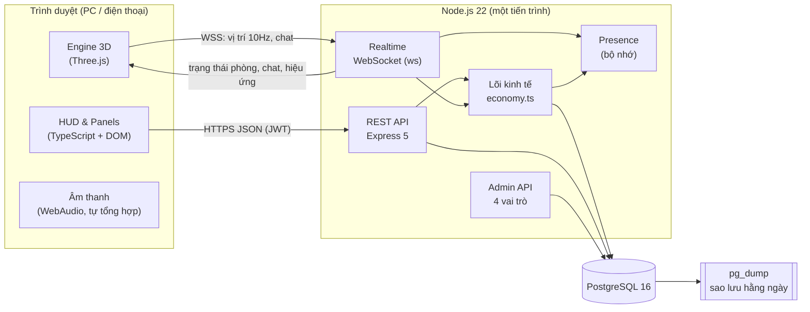
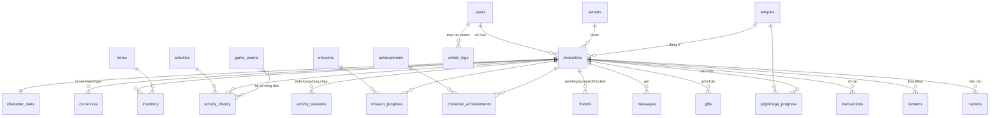

# Tâm An Online – Kiến trúc hệ thống

## 1. Sơ đồ kiến trúc



**Nguyên tắc chính**
- **Server là nguồn sự thật.** Client chỉ gửi *ý định* (lạy, lần N hạt, bắt đầu/kết thúc thiền, mua X). Server kiểm tra rồi mới cộng thưởng.
- **Mọi thay đổi tài nguyên** đi qua `economy.ts`, chạy trong transaction có khóa dòng (`FOR UPDATE`) và ghi vào bảng `transactions`.
- **Realtime tách khỏi kinh tế.** WebSocket chỉ đồng bộ vị trí, hoạt ảnh và chat. Phần thưởng luôn đi qua API có xác thực.
- **Vị trí do server xác thực.** Server dùng vị trí này để kiểm tra khu vực khi lạy Phật, thắp hương… và để cấp dấu mộc hành hương.

## 2. Sơ đồ database



Đủ 20 bảng theo yêu cầu, cộng 5 bảng phụ trợ:

| Bảng yêu cầu | Bảng trong schema |
|---|---|
| Users | `users` (vai trò, khóa, cấm chat, `token_version` để thu hồi phiên) |
| Characters | `characters` (pháp danh duy nhất, ngoại hình, `equipment`, vị trí, chùa hiện tại) |
| Servers | `servers` |
| Character_Stats | `character_stats` (cấp, EXP, bộ đếm hoạt động, tiến độ hạt) |
| Inventory | `inventory` (CHECK `quantity >= 0`) |
| Items | `items` (giá Sen/Ngọc, ô trang bị trong `data`) |
| Currencies | `currencies` (CHECK `balance >= 0`) |
| Activities | `activities` (thưởng, nhịp tối thiểu, giới hạn ngày, vật phẩm tiêu hao, khu vực) |
| Activity_History | `activity_history` |
| Missions | `missions` (metric, target, reset, phần thưởng, thời hạn) |
| Mission_Progress | `mission_progress` (khóa theo kỳ: ngày / tuần ISO / một lần) |
| Achievements | `achievements` + `character_achievements` |
| Friends | `friends` (kiêm danh sách chặn) |
| Messages | `messages` (chung/riêng, ẩn khi vi phạm) |
| Gifts | `gifts` |
| Temples | `temples` (khu vực dấu mộc dạng JSON) |
| Pilgrimage_Progress | `pilgrimage_progress` |
| Transactions | `transactions` (sổ cái mọi thay đổi) |
| Game_Events | `game_events` (hệ số công đức theo thời gian) |
| Admin_Logs | `admin_logs` |
| *(phụ trợ)* | `activity_sessions`, `lanterns`, `reports`, `character_achievements`, `schema_migrations` |

Schema đầy đủ: `server/migrations/001_init.sql`. Dữ liệu khởi tạo: `002_seed.sql`.

## 3. Cấu trúc thư mục

```
.
├── client/                    # Frontend (Vite)
│   ├── index.html             # Game
│   ├── admin.html             # Trang quản trị
│   ├── public/favicon.svg
│   └── src/
│       ├── main.ts            # Luồng: đăng nhập → máy chủ → nhân vật → game
│       ├── api.ts, net.ts     # REST + WebSocket (tự kết nối lại)
│       ├── audio.ts           # Chuông, mõ, hạt, nhạc nền (WebAudio)
│       ├── style.css, admin.css
│       ├── admin.ts           # Trang quản trị
│       ├── ui/
│       │   ├── dom.ts         # Tiện ích DOM, biểu tượng, toast, modal
│       │   ├── screens.ts     # Đăng nhập/ký, mã khôi phục, máy chủ, tạo nhân vật
│       │   └── hud.ts         # HUD, chat, minimap, mọi panel trong game
│       └── world/
│           ├── layout.ts      # Bố cục bản đồ, va chạm, chủ đề 3 chùa, điểm tương tác
│           ├── temple.ts      # Dựng chùa 3D bằng mã
│           ├── character.ts   # Nhân vật + hoạt ảnh thủ tục
│           └── game.ts        # Renderer, camera, điều khiển, ngày/đêm, hiệu ứng
├── server/
│   ├── migrations/            # SQL schema + seed
│   ├── src/
│   │   ├── index.ts           # Khởi động: migrate → HTTP + WS
│   │   ├── app.ts             # Định tuyến REST
│   │   ├── auth.ts            # Đăng ký/nhập/khôi phục, JWT, phân quyền
│   │   ├── economy.ts         # Lõi kinh tế (hoạt động, nhiệm vụ, thành tựu, cấp)
│   │   ├── game.ts            # Nhân vật, cửa hàng, trang bị, bạn bè, quà, xếp hạng
│   │   ├── realtime.ts        # WebSocket: phòng, vị trí, chat, dấu mộc
│   │   ├── presence.ts        # Trạng thái online trong bộ nhớ, cộng tu
│   │   ├── admin.ts           # Admin API
│   │   └── config.ts, db.ts, time.ts, errors.ts, migrate.ts
│   └── test/api.test.ts       # 18 test tích hợp trên PostgreSQL thật
├── shared/content.ts          # Kinh văn, công thức cấp, khu vực, bộ lọc từ (dùng chung)
├── scripts/e2e.mjs            # Kiểm thử E2E 2 người chơi bằng Playwright
├── scripts/backup.sh          # Sao lưu pg_dump có xoay vòng
├── docs/                      # GDD, kiến trúc, tiến độ
└── prototype/                 # Bản tĩnh đầu tiên (giữ để tham khảo)
```

## 4. Công nghệ & lý do chọn

| Lớp | Chọn | Lý do | Cân nhắc đã loại |
|---|---|---|---|
| 3D | **Three.js** (thuần) | Nhẹ, chạy tốt trên điện thoại tầm trung, toàn quyền kiểm soát vòng render | React Three Fiber: thêm React (~45 KB gzip) và một lớp trừu tượng không cần ở MVP |
| UI | **TypeScript + DOM** | HUD ít trạng thái chéo, cập nhật theo sự kiện; bundle nhỏ | React/Next.js: SSR vô ích cho game WebGL; có thể chuyển sang React khi UI phức tạp hơn |
| CSS | CSS thuần + biến | Một bộ token cho cả game | Tailwind: không cần cho khoảng 20 thành phần |
| Build | **Vite** | Nhanh, multi-page (game + admin), proxy WS khi dev | — |
| Server | **Node 22 + Express 5** | Chạy thẳng TypeScript (type stripping), không cần bước build; Express 5 tự bắt lỗi async | NestJS: nặng cho MVP một tiến trình |
| Realtime | **ws** | Giao thức JSON tối giản, không phụ thuộc client lớn | Socket.IO: thêm khoảng 40 KB client, fallback polling không cần |
| DB | **PostgreSQL 16** | Transaction, CHECK constraint, JSONB, khóa dòng: đúng nhu cầu kinh tế game | — |
| Cache/online | **Bộ nhớ tiến trình** | Một máy chủ game đủ cho vài trăm CCU. `presence.ts` gom vào một chỗ để thay bằng Redis | Redis: thêm hạ tầng khi chưa cần. **Kích hoạt khi chạy nhiều tiến trình.** |
| Auth | bcrypt + JWT + `token_version` | Thu hồi phiên khi khóa tài khoản hoặc đổi mật khẩu | — |

### Khi nào cần mở rộng
| Ngưỡng | Hành động |
|---|---|
| > 300 người online / tiến trình | Tách tiến trình game theo máy chủ (s1, s2…). Presence và cộng tu chuyển sang Redis pub/sub. |
| > 1 tiến trình API | Đặt sau load balancer có sticky session cho `/ws` |
| Tài nguyên 3D nặng (mô hình GLB) | Đưa lên CDN, nén Draco/meshopt |

## 5. Kế hoạch triển khai theo giai đoạn

| GĐ | Mục tiêu | Trạng thái | Tệp chính | Tiêu chí nghiệm thu | Lỗi cần kiểm tra |
|---|---|---|---|---|---|
| 1 | Nghiên cứu game tham chiếu | 🟡 Bị chặn mạng | `docs/GDD.md` §1 | Phân loại rõ tính năng đã xác minh / suy luận / đề xuất | Không suy diễn tính năng chưa kiểm chứng |
| 2 | Game Design Document | ✅ | `docs/GDD.md` | Đủ tính năng, luồng, kinh tế, an toàn | Kinh tế có trần cứng |
| 3 | UI/UX | ✅ MVP | `client/src/ui/*`, `style.css` | 18 màn hình, chạy được trên PC và mobile, không có nút trang trí | Tràn ngang trên mobile, che cảnh 3D |
| 4 | 3D & bản đồ | ✅ MVP | `client/src/world/*` | 3 chùa, đủ khu vực, ngày/đêm, hiệu ứng | FPS trên máy yếu, xuyên tường |
| 5 | Nhân vật & gameplay | ✅ | `character.ts`, `game.ts`, `hud.ts` | Di chuyển, camera, 7 hoạt động có hoạt ảnh | Kẹt va chạm, hoạt ảnh không về idle |
| 6 | Backend & DB | ✅ | `server/*`, `migrations/*` | 18 test tích hợp đạt | Đua dữ liệu (race), số dư âm |
| 7 | Multiplayer | ✅ | `realtime.ts`, `net.ts` | 2 trình duyệt thấy nhau, chat, chống dịch chuyển | Rớt mạng và kết nối lại, đăng nhập 2 nơi |
| 8 | Nhiệm vụ, tài nguyên, cửa hàng | ✅ | `economy.ts`, `game.ts` | Nhận thưởng 1 lần/kỳ, mua và trang bị | Nhận thưởng 2 lần, mua trùng |
| 9 | Trang quản trị | ✅ | `admin.ts`, `client/src/admin.ts` | 4 vai trò, mọi thao tác ghi log | Leo quyền |
| 10 | Kiểm thử, tối ưu, triển khai | 🟡 | `scripts/*`, `docs/PROGRESS.md` | E2E đạt; hướng dẫn deploy | Hiệu năng mobile thật, tải 100+ CCU |
