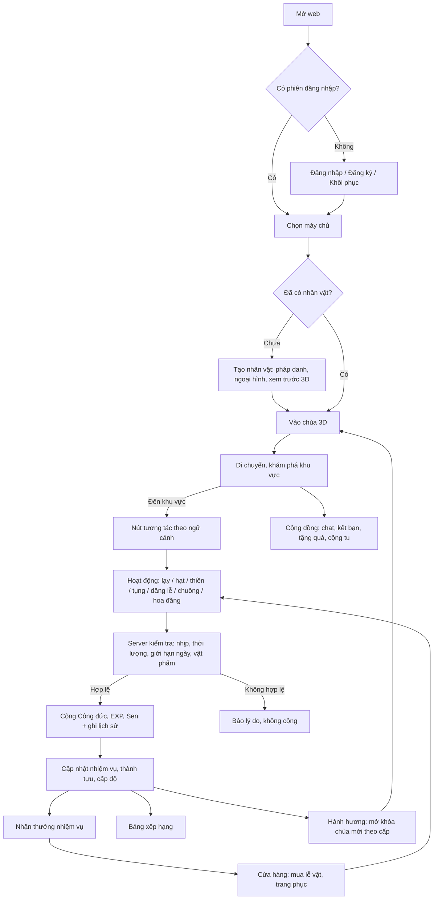

# Tâm An Online – Game Design Document

Phiên bản: 0.1 (MVP) · Cập nhật: 02/11/2026

Tâm An Online là game web 3D mô phỏng không gian chùa Việt. Người chơi tạo nhân vật, đi lại trong chùa, tham gia các hoạt động tu tập, nhận nhiệm vụ, tích công đức và giao lưu với người chơi khác theo thời gian thực.

Sản phẩm độc lập: tên gọi, nhận diện, mô hình 3D, âm thanh, nội dung và mã nguồn đều được xây mới. Không dùng mã, hình ảnh, thương hiệu hay tài sản của bất kỳ game nào khác.

---

## 1. Phân tích game tham chiếu (Giai đoạn 1)

### 1.1 Giới hạn nghiên cứu

Môi trường phát triển (máy cloud) **chặn truy cập** `niemphat.online` và `s2.niemphat.online` (lỗi DNS `ENOTFOUND` do chính sách mạng). Vì vậy:

| Nhóm | Nội dung |
|---|---|
| **Tính năng đã xác minh** | **Không có.** Chưa truy cập được game nên không xác minh được chức năng nào. |
| **Tính năng suy luận** | Chỉ từ mô tả của chủ dự án: game web chủ đề niệm Phật, có nhiều máy chủ (tên miền `s2.` gợi ý máy chủ số 2), có cộng đồng người chơi. Đây là suy luận, chưa kiểm chứng. |
| **Tính năng đề xuất** | Toàn bộ danh sách ở mục 2 là đặc tả độc lập của Tâm An Online, xây theo master prompt của chủ dự án. |

Không mô tả chi tiết cơ chế, chỉ số hay giao diện của game tham chiếu, vì chưa kiểm chứng được.

### 1.2 Phân tích thể loại (kiến thức chung)

Các ứng dụng "tu tập số" (gõ mõ, đếm chuỗi hạt, thiền) giữ chân người dùng bằng ba động lực:

1. **Nghi thức lặp lại ngắn**: một thao tác cho phản hồi ngay (âm thanh, hiệu ứng, con số tăng).
2. **Tiến trình tích lũy**: bộ đếm, cấp độ, chuỗi ngày.
3. **Cảm giác cộng đồng**: thấy người khác cùng tu tập, bảng xếp hạng, lời nguyện chung.

Rủi ro của thể loại:
- Farm vô hạn bằng macro làm mất giá trị bảng xếp hạng.
- "Thương mại hóa công đức" gây phản cảm.
- Nội dung chat thiếu kiểm duyệt.

Thiết kế của Tâm An Online xử lý cả ba rủi ro (mục 5 và 7).

---

## 2. Danh sách tính năng

Trạng thái: ✅ có trong MVP · 🟡 có một phần · ⏳ kế hoạch giai đoạn sau.

### 2.1 Tài khoản & máy chủ
| Tính năng | Trạng thái | Ghi chú |
|---|---|---|
| Đăng ký / đăng nhập (tên đăng nhập + mật khẩu) | ✅ | bcrypt, JWT |
| Quên mật khẩu / khôi phục tài khoản | ✅ | Bằng **mã khôi phục** cấp lúc đăng ký (không cần email) |
| Chọn máy chủ | ✅ | Bảng `servers`, mỗi máy chủ là một phòng multiplayer riêng |
| Tiếp tục chơi | ✅ | Ghi nhớ phiên đăng nhập trên thiết bị |
| Đăng nhập Google/Facebook | ⏳ | Cần OAuth client ID của chủ dự án. **Không hiển thị nút** cho tới khi có. |
| Khôi phục qua email | ⏳ | Cần dịch vụ gửi mail |

### 2.2 Nhân vật
| Tính năng | Trạng thái |
|---|---|
| Pháp danh (duy nhất, kiểm duyệt từ cấm) | ✅ |
| Giới tính, kiểu tóc, màu da, màu áo tràng | ✅ |
| Xem trước nhân vật 3D, xoay được | ✅ |
| Đổi trang phục bằng vật phẩm trong túi đồ | ✅ |

### 2.3 Thế giới 3D
| Tính năng | Trạng thái |
|---|---|
| Cổng tam quan, sân, chánh điện, tượng Phật, bàn thờ, bồ đoàn | ✅ |
| Lư hương, bàn dâng hoa, nến, gác chuông | ✅ |
| Ao sen, hồ hoa đăng, khu thiền, giảng đường tụng kinh, cây, lối đi | ✅ |
| Ngày/đêm theo giờ Việt Nam, đèn lồng sáng ban đêm | ✅ |
| Khói hương, nước gợn sóng, hoa sen, cánh hoa rơi | ✅ |
| Chuông chùa, nhạc nền thiền (tổng hợp bằng WebAudio, không dùng file bản quyền) | ✅ |
| 3 ngôi chùa (bản đồ khác nhau): Tâm An Tự, Vân Sơn Tự, Hải Nguyệt Tự | ✅ |
| Thời tiết (mưa, sương) | 🟡 Sương núi ở Vân Sơn Tự; mưa ⏳ |

### 2.4 Gameplay tu tập
| Hoạt động | Trạng thái | Nơi thực hiện |
|---|---|---|
| Lạy Phật (hoạt ảnh quỳ, cúi) | ✅ | Trong chánh điện |
| Lần tràng hạt 108 | ✅ | Mọi nơi |
| Thiền định (5/10/15/30 phút, nhịp thở) | ✅ | Khu thiền hoặc bồ đoàn |
| Tụng kinh (đọc theo dòng, đếm tiến trình) | ✅ | Giảng đường |
| Thắp hương, thắp nến, dâng hoa | ✅ | Lư hương, bàn thờ |
| Thỉnh chuông | ✅ | Gác chuông |
| Thả hoa đăng (mọi người cùng thấy) | ✅ | Hồ hoa đăng |
| Nghe tụng kinh bằng audio | ⏳ | Cần bản ghi hợp pháp |

### 2.5 Hệ thống phát triển
| Tính năng | Trạng thái |
|---|---|
| Công đức, Kinh nghiệm, Sen, Ngọc | ✅ |
| Cấp độ, phần thưởng lên cấp | ✅ |
| Nhiệm vụ ngày / tuần / đặc biệt / hành hương / cộng đồng (cấu hình trong DB) | ✅ |
| Thành tựu, danh hiệu | ✅ |
| Cửa hàng: lễ vật, trang phục, vật phẩm, trang trí, đặc biệt (Ngọc) | ✅ |
| Túi đồ, lịch sử giao dịch | ✅ |
| Hộ chiếu hành hương, dấu mộc theo khu vực | ✅ |
| Sự kiện (ví dụ Rằm x2 công đức) | ✅ |
| Trang trí phòng riêng | ⏳ |

### 2.6 Cộng đồng
| Tính năng | Trạng thái |
|---|---|
| Nhiều người cùng bản đồ, đồng bộ vị trí và hoạt ảnh | ✅ |
| Pháp danh trên đầu nhân vật | ✅ |
| Chat công khai, chat riêng | ✅ |
| Kết bạn, lời mời, danh sách bạn, tìm người chơi | ✅ |
| Tặng quà (Sen hoặc vật phẩm) | ✅ |
| Hoạt động tập thể: **Cộng tu** (≥3 người cùng tu trong 60 giây thì +20% công đức) | ✅ |
| **Đại lễ cộng tu** 6:00 và 20:00 giờ VN (ngày Rằm/mùng Một thêm 12:00, công đức x2): cả máy chủ tụng đồng bộ Tâm Kinh, niệm hồng danh, hồi hướng; cần có mặt ở Chánh điện ≥ 80% thời gian; +2% mỗi người dự (tối đa +40%) | ✅ |
| Bảng xếp hạng (công đức, cấp, thời gian thiền) | ✅ |
| Chặn, báo cáo, lọc từ cấm, chống spam | ✅ |

### 2.7 Quản trị
| Tính năng | Trạng thái |
|---|---|
| Trang admin riêng, 4 vai trò | ✅ |
| Người chơi: tìm, xem, khóa/mở, cấm chat, điều chỉnh tài nguyên (có ghi log) | ✅ |
| Máy chủ, nhiệm vụ, vật phẩm, sự kiện, chùa: xem và sửa | ✅ |
| Giao dịch, báo cáo vi phạm, nhật ký admin, người online, thống kê | ✅ |

---

## 3. Sơ đồ luồng gameplay



### Vòng lặp chính
- **Phiên 5 phút:** vào chùa → thắp hương → lạy Phật → lần một chuỗi hạt → nhận nhiệm vụ ngày.
- **Phiên 20 phút:** thêm thiền 10 phút, tụng kinh, thả hoa đăng, chat.
- **Dài hạn:** lên cấp, mở chùa mới, sưu tầm dấu mộc hành hương, danh hiệu, trang phục.

---

## 4. Danh sách màn hình UI

| # | Màn hình | Thành phần |
|---|---|---|
| 1 | Đăng nhập | Tab đăng nhập/đăng ký/quên mật khẩu, nút "Tiếp tục với tên X" nếu đã có phiên |
| 2 | Hiển thị mã khôi phục | Hiện một lần sau đăng ký, nút sao chép |
| 3 | Chọn máy chủ | Danh sách máy chủ, số người online, trạng thái |
| 4 | Tạo nhân vật | Pháp danh, giới tính, tóc, da, áo tràng, xem trước 3D xoay được |
| 5 | HUD trong game | Mục 5 bên dưới |
| 6 | Hồ sơ | Cấp, EXP, tài nguyên, danh hiệu đang dùng, thành tựu, lịch sử hoạt động |
| 7 | Túi đồ & trang phục | Vật phẩm, số lượng, mặc/dùng |
| 8 | Nhiệm vụ | Tab Ngày / Tuần / Đặc biệt / Hành hương / Cộng đồng, thanh tiến trình, nút nhận thưởng |
| 9 | Cửa hàng | Tab Lễ vật / Trang phục / Vật phẩm / Trang trí / Đặc biệt, lịch sử giao dịch |
| 10 | Cộng đồng | Online, tìm kiếm, bạn bè, lời mời, chặn, bảng xếp hạng |
| 11 | Chat | Kênh chung + tab chat riêng, báo cáo tin nhắn |
| 12 | Hành hương | Bản đồ 3 chùa, thông tin, điều kiện mở khóa, hộ chiếu dấu mộc |
| 13 | Bảng tràng hạt | 108 hạt, đếm, số chuỗi |
| 14 | Bảng thiền | Chọn thời lượng, vòng thở, đồng hồ |
| 15 | Bảng tụng kinh | Danh sách bài, nội dung, đánh dấu dòng, tiến trình |
| 16 | Hoa đăng | Ô viết lời nguyện |
| 17 | Menu hệ thống | Âm thanh, nhạc, đổi máy chủ, đăng xuất, hướng dẫn phím |
| 18 | Admin | Đăng nhập, Tổng quan, Người chơi, Máy chủ, Nhiệm vụ, Vật phẩm, Sự kiện, Chùa, Giao dịch, Báo cáo, Nhật ký |

---

## 5. Thiết kế màn hình chính (HUD)

Nguyên tắc: không gian 3D chiếm tối thiểu 75% màn hình. Panel mở dạng ngăn kéo, có nút đóng, và tự đóng khi người chơi di chuyển.

```
┌──────────────────────────────────────────────────────────────────────┐
│ [Avatar] Pháp danh · Cấp 7        Công đức 1.240  Sen 85  Ngọc 2   ☰ │  ← thanh trên
│ ▓▓▓▓▓▓▓░░░ EXP 340/520                                    ┌──────┐  │
│                                                            │ mini │  │
│ ┌ Nhiệm vụ ngày ──────┐                                    │ map  │  │
│ │ Lạy Phật 12/20      │                                    └──────┘  │
│ │ Lần 1 chuỗi hạt 0/1 │                                  Xung quanh: │
│ └─────────────────────┘          (KHÔNG GIAN 3D)          · Minh Tâm  │
│                                                           · Diệu Hạnh │
│                    [ Thông báo sự kiện / toast ]                      │
│                                                                      │
│ ┌ Chat ───────────────┐            [ E  Thắp hương ]                 │  ← nút ngữ cảnh
│ │ Minh Tâm: A Di Đà… │                                               │
│ └─────────────────────┘                                              │
│  🙇 Lạy   📿 Hạt   🧘 Thiền   📖 Kinh   🔔   👤  📜  🏪  👥  🗺        │  ← thanh thao tác
└──────────────────────────────────────────────────────────────────────┘
```

Trên điện thoại:
- Joystick ảo ở góc dưới trái; vuốt nửa phải để xoay camera; chụm hai ngón để zoom.
- Nút tương tác lớn ở góc dưới phải.
- Nhiệm vụ, chat và danh sách xung quanh thu thành biểu tượng.
- Thanh thao tác cuộn ngang.

---

## 6. Hệ thống tài nguyên & cân bằng kinh tế

### 6.1 Tài nguyên
| Tài nguyên | Vai trò | Nguồn | Tiêu |
|---|---|---|---|
| **Công đức** | Điểm ghi nhận tu tập, xếp hạng. **Không tiêu được, không đổi được.** | Mọi hoạt động | — |
| **Kinh nghiệm (EXP)** | Lên cấp | Mọi hoạt động | — |
| **Sen** | Tiền tệ thường | Hoạt động, nhiệm vụ, lên cấp, quà tặng | Lễ vật, trang phục, trang trí |
| **Ngọc** | Tiền tệ hiếm. **Không bán bằng tiền thật trong MVP.** | Nhiệm vụ tuần, thành tựu, mốc cấp 5/10/15… | Vật phẩm đặc biệt |
| **Vật phẩm lễ** | Hương, nến, hoa, hoa đăng | Cửa hàng, quà đăng nhập hằng ngày | Dâng lễ |
| **Danh hiệu** | Hiển thị cạnh pháp danh | Thành tựu | — |
| **Điểm thành tựu** | Tổng điểm thành tựu | Thành tựu | — |

> Công đức trong game là điểm ghi nhận hoạt động trong trò chơi, **không có giá trị tâm linh thực tế** và không quy đổi ra tiền hay vật phẩm. Thông điệp này hiển thị trong hồ sơ người chơi.

### 6.2 Bảng hoạt động (server là nguồn sự thật)

| Hoạt động | Điều kiện server kiểm tra | Công đức | EXP | Sen | Giới hạn thưởng/ngày |
|---|---|---|---|---|---|
| Lạy Phật | Cách lần trước ≥ 2,5 giây (thời lượng hoạt ảnh) | 1 | 2 | 0 | 300 lần |
| Lần hạt | Mỗi hạt cách ≥ 0,25 giây; thưởng khi đủ 108 hạt | 10/chuỗi | 15 | 5 | 20 chuỗi |
| Thiền | Thời gian thực trôi qua ≥ 98% thời lượng chọn | 2/phút | 3/phút | 1/phút | 120 phút |
| Tụng kinh | Thời gian ≥ thời lượng tối thiểu của bài | 15 | 20 | 5 | 10 lần |
| Thắp hương | Tiêu 1 Hương; hồi 5 phút | 8 | 5 | 0 | 20 |
| Thắp nến | Tiêu 1 Nến; hồi 5 phút | 6 | 4 | 0 | 20 |
| Dâng hoa | Tiêu 1 Hoa; hồi 5 phút | 6 | 4 | 0 | 20 |
| Thỉnh chuông | Hồi 30 giây | 1 | 1 | 0 | 30 |
| Thả hoa đăng | Tiêu 1 Hoa đăng; lời nguyện qua bộ lọc | 12 | 8 | 0 | 10 |
| Đại lễ cộng tu | Có mặt ở Chánh điện ≥ 80% thời gian (server lấy mẫu 5 giây/lần) | 30 × hệ số | 40 | 15 | 3 buổi |
| Khám phá khu vực | Lần đầu đứng trong vùng (server kiểm tra vị trí) | 5 | 10 | 5 | 1 lần mỗi khu |

Quy tắc chung:
- **Vượt giới hạn ngày:** hoạt động vẫn làm được (vẫn có hoạt ảnh, vẫn ghi lịch sử) nhưng **không cộng thưởng**, có thông báo rõ.
- **Cộng tu:** ≥3 người khác nhau cùng làm hoạt động trên cùng máy chủ và cùng chùa trong 60 giây thì +20% công đức.
- **Sự kiện:** hệ số nhân công đức (ví dụ Rằm x2) do admin cấu hình, server tự áp dụng.
- **Quà đăng nhập hằng ngày:** 3 Hương, 2 Nến, 2 Hoa, 1 Hoa đăng.

### 6.3 Cấp độ
EXP cần để lên cấp L+1 = `round(60 · L^1.5)`, tức cấp 1→2 cần 60, cấp 10→11 cần 1.897.

Phần thưởng lên cấp:
- `10 × L` Sen.
- Mỗi mốc chia hết cho 5: +1 Ngọc.

Mở khóa chùa: Vân Sơn Tự từ cấp 3, Hải Nguyệt Tự từ cấp 6.

### 6.4 Ước lượng kinh tế (người chơi chăm, 30 phút/ngày)
| Nguồn | Sen/ngày |
|---|---|
| 3 chuỗi hạt | 15 |
| Thiền 10 phút | 10 |
| 2 lần tụng kinh | 10 |
| Nhiệm vụ ngày (5 nhiệm vụ) | ~60 |
| **Tổng** | **~95** |

Chi phí tham chiếu:
- Lễ vật 5–10 Sen.
- Áo tràng thường 120–300 Sen, tức khoảng 2–3 ngày chơi.
- Vật phẩm đặc biệt 3–10 Ngọc, khoảng 1–3 tuần.

Trần cứng theo ngày làm cho người dùng macro cũng chỉ hơn người chơi chăm khoảng 2 lần, không phải vô hạn.

---

## 7. An toàn, chống gian lận, kiểm duyệt

- **Client không bao giờ gửi số tài nguyên.** Client chỉ gửi *ý định hành động*; server tính phần thưởng, khóa dòng (`SELECT … FOR UPDATE`) và ghi `transactions`.
- **Nhịp tối thiểu** cho từng hoạt động, thời lượng thực cho thiền và tụng kinh, giới hạn theo ngày.
- **Vị trí:** server kiểm tra tốc độ di chuyển (≤ 9 m/s, có dung sai). Sai thì kéo nhân vật về vị trí hợp lệ. Hoạt động theo khu vực được kiểm tra bằng vị trí do server ghi nhận.
- **Chat:** tối đa 5 tin/10 giây, tối đa 200 ký tự, lọc từ cấm (thay bằng ***), chặn tin lặp lại.
- **Chặn người chơi:** không nhận tin riêng, lời mời hay quà từ người bị chặn.
- **Báo cáo vi phạm:** vào hàng đợi admin. Moderator có thể cấm chat hoặc khóa tài khoản.
- **Tặng quà:** tối đa 200 Sen/ngày mỗi người gửi, chỉ tặng bạn bè, tài khoản phải ≥ cấp 3 để chống tạo tài khoản ảo chuyển Sen.
